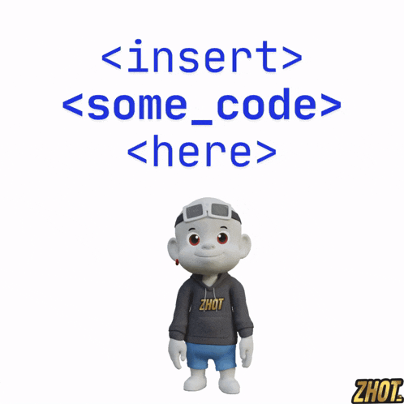

# Hi, I'm Phinehas 👋

I'm a curious developer passionate about turning ideas into useful software and solving real-world problems with technology.

I enjoy exploring how technology can make everyday tasks easier, improve the way people work, and bring practical ideas to life. I’m continually learning, building projects, and improving my skills one step at a time.

## What I'm passionate about

- Turning ideas into working software
- Solving practical problems with technology
- Learning new tools and improving my development skills
- Building projects that are useful, clear, and easy to use

## What you'll find here

This GitHub profile is where I share projects, experiments, and things I’m learning. Some projects may be works in progress; each one is part of my journey to become a better developer and create software that makes a difference.

## My approach

I believe good software starts with understanding a problem, exploring possible solutions, and learning through building. I value curiosity, consistency, and the willingness to improve.

## Let's connect

I'm always open to learning, sharing ideas, and collaborating on projects that use technology to solve meaningful problems.

